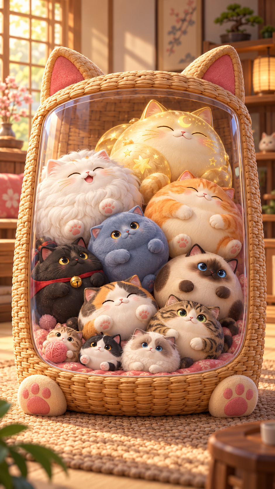
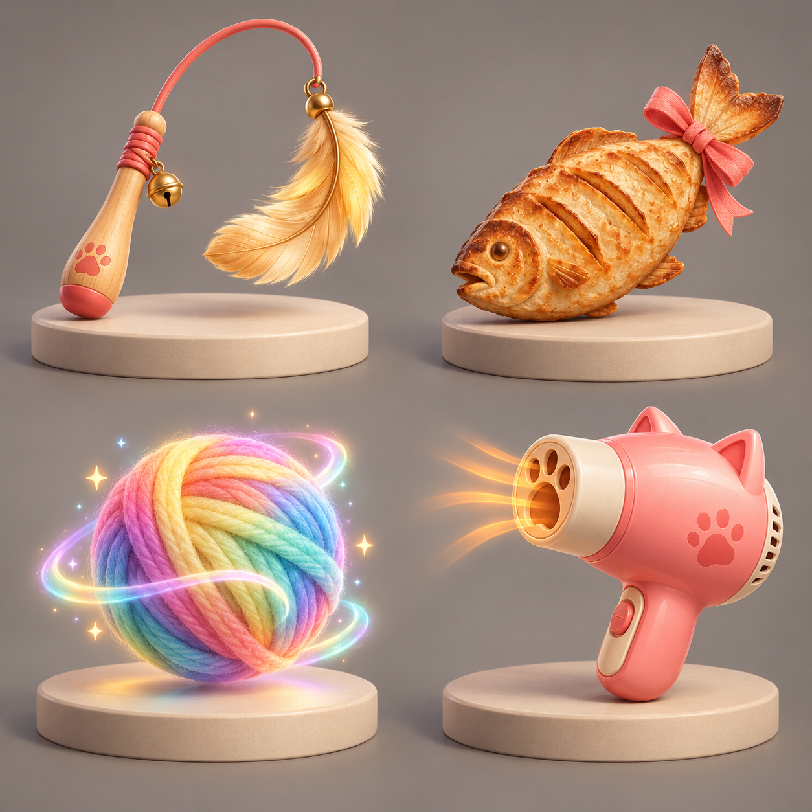
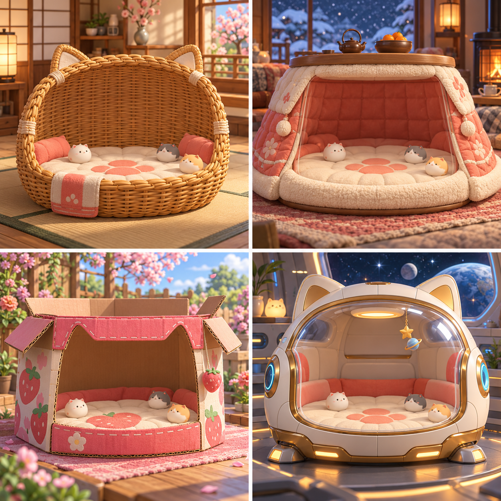
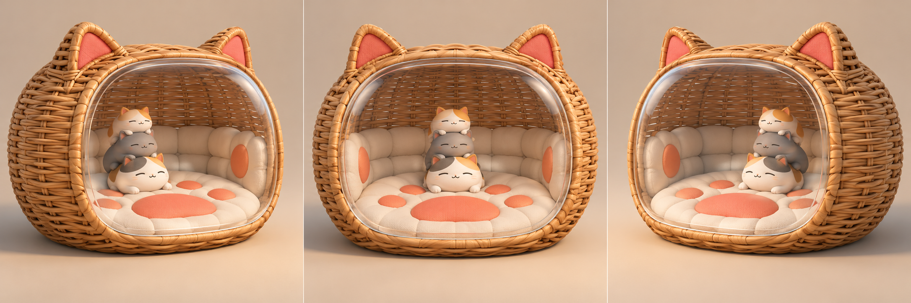

# 《猫咪团子》3D 美术设计与资源清单

> 版本：v1.0  
> 对应主策划：v2.2.0  
> 定位：3D 表现、2.5D 受约束堆叠、竖屏正面玩法、水平拖动小角度观察  
> 用途：概念设计、建模、绑定、动画、材质、灯光、VFX、UI 图标和外包验收的统一依据

---

## 一、视觉总纲

### 1.1 核心概念：可以揉捏的猫咪微缩屋

游戏画面像一个放在温暖房间里的精致猫窝玩具。猫咪不是毛球贴图，而是有真实体积、能被挤压回弹的“猫咪团子”：轮廓圆、重心低、四肢短、五官集中，远看先读等级体型，近看再读品种和性格。

视觉优先级固定为：

1. 猫咪等级与轮廓可读；
2. 容器有效空间和危险线可读；
3. 合成、落地和危险反馈可读；
4. 角色性格与主题装饰；
5. 背景氛围。

背景、玻璃高光、编织纹理和粒子不得抢过猫咪脸部与堆叠边界。

### 1.2 造型语言

* **猫咪**：圆润雕塑体，身体主质量约占整体轮廓 `70%~80%`；耳朵、爪、尾巴必须有清晰根部和厚度，不能像贴片插在球上。
* **容器**：外轮廓有猫耳识别点，侧壁和底框厚实，前窗尽量开阔；从 `±16°` 角度仍能看到完整危险区。
* **道具**：一眼识别功能，每个道具只保留 1 个主轮廓和 1 个强调运动部件。
* **场景**：微缩模型感，使用少量比例偏大的生活物件做背景，不堆砌小摆件。

### 1.3 材质方向

| 材质族 | 视觉定义 | 禁止结果 |
| :--- | :--- | :--- |
| 猫咪身体 | 哑光软胶基底 + 极弱短绒 sheen；边缘柔和、脸部清晰 | 全身高光塑料、真实长毛 groom、噪点毛孔 |
| 编织藤条 | 有明确编织方向、厚度和交叠阴影；微粗糙 | 仅贴一张平面藤编纹理 |
| 布料软垫 | 大块绗缝、压线和接缝，触感松软 | 高频布纹覆盖所有表面 |
| 透明前窗 | 低反射透明亚克力，边缘有厚度，正面不产生大片白斑 | 玻璃高光遮住猫脸、真实重折射导致画面扭曲 |
| 金属/塑料 | 仅用于太空舱和吹风机；缎面、圆角、控制高光 | 所有主题共用同一种亮塑料 |
| 魔法发光 | 发光只用于彩虹球、终阶猫和关键反馈 | 常驻过曝、彩虹污染整个画面 |

### 1.4 核心色板

* 奶油白 `#F6E9D4`：UI、安全背景、布料基础。
* 蜂蜜藤 `#C98A46`：经典猫窝主体。
* 珊瑚粉 `#E9857D`：品牌强调、危险线以外的情绪色。
* 深可可 `#5A4038`：轮廓、文字和结构阴影。
* 雾青绿 `#6FA9A3`：冷填充与互补色。
* 庆典金 `#F4C75B`：Lv11 与稀有反馈，常驻面积不超过画面的 `8%`。

---

## 二、概念图交付

### 2.1 主玩法视觉

用途：确定猫窝占屏、主材质、温暖室内气氛、猫咪体积感与等级递增关系。概念图用于方向确认，不代表最终堆叠数量、碰撞尺寸或 UI 位置。

### 2.2 四大道具

用途：确定逗猫棒、香酥鱼干、魔法彩虹球和猫咪吹风机的主轮廓与材质差异。

### 2.3 四套主题场景

用途：确定经典编织、暖桌软窝、草莓纸箱和星际猫舱的模块化方向。四套主题必须复用同一有效物理边界。

### 2.4 镜头角度对照

用途：验证 `-16° / 0° / +16°` 观察角下，前窗、侧壁和堆叠区仍然可读。最终模型需用同一镜头、同一堆叠快照重新输出工程验证图。

### 2.5 单资产四视图设定

新增 [单资产四视图索引](turnarounds/README.md)，覆盖 11 只角色、4 个玩法道具和 4 套主题容器，每个资产独立一张四格 PNG。

* 角色：正面、背面、侧面、短前肢横向展开的 T-pose。
* 道具与容器：正面、背面、侧面、拆件结构图；不套用角色 T-pose。
* 生成图为造型参考，不能替代从同一模型导出的正投影尺寸图；建模时校正各面花纹、视角与比例。
* 容器结构补充：顶部必须有不阻挡投放的开口；暖桌实心顶板改为开口木围框，太空舱保留顶口。原氛围图的封顶效果不作为玩法结构依据。

---

## 三、3D 世界、镜头与交互规范

### 3.1 坐标与尺度

* 世界坐标：`+X` 向屏幕右，`+Y` 向上，`+Z` 朝默认正面镜头。
* DCC 与引擎统一 Y-Up；猫咪正脸朝 `+Z`。
* `1 engine unit = 100lu`；容器有效宽度 `6.4u`，危险线高度 `6.6u`。
* 模型导出前冻结缩放；根节点缩放必须为 `(1,1,1)`，禁止依赖负缩放镜像。

### 3.2 玩法维度

采用 **3D 渲染 + 2.5D 物理**：猫咪是完整 3D 模型与球形碰撞体，但刚体中心约束在 `Z=0` 的玩法平面，仅允许 X/Y 平移与绕 Z 轴旋转。镜头环绕只改变观察方式，不改变碰撞、落点、合成或危险线结果。

采用这一结构的原因：

* 保留 3D 体积、灯光、材质和侧面观察；
* 保留合成玩法的可预测性；
* 防止猫咪在深度方向互相遮挡、钻缝或制造玩家看不见的接触；
* 所有镜头角度共享同一局面回放。

### 3.3 镜头参数

| 参数 | 初值 | 规则 |
| :--- | :---: | :--- |
| 投影 | 透视 | FOV 初值 `30°`，目标是接近正交的产品展示感 |
| 目标点 | 容器中心偏上 | 始终 `lookAt(ContainerFocus)` |
| 水平环绕 | `-16° ~ +16°` | 绕世界 Y 轴，不旋转玩法坐标 |
| 俯仰 | 固定 | 不响应纵向滑动，不开放上下观察 |
| 距离/缩放 | 固定 | 不响应双指缩放；适配只改统一画布比例 |
| 滤波 | `100~140ms` 临界阻尼 | 松手后最多 `180ms` 轻惯性，不自动回正 |
| 一键回正 | HUD 小按钮 | `180ms` ease-out 回到 `0°` |

### 3.4 手势冲突处理

* **顶部投放区**水平拖动：移动投放猫爪，不旋转镜头。
* **容器边框、背景和两侧留白区**水平拖动：旋转观察角。
* 道具 Targeting、危险倒计时最后 1 秒、结算和广告返回恢复阶段：锁定镜头输入。
* 手势位移超过 `8dp` 且水平/垂直位移比 `>1.3` 后才锁定为水平拖动；锁定后本次手势不切换用途。
* 镜头变化不能移动 HUD、危险线屏幕提示或投放落点逻辑；落点由射线与 `Z=0` 玩法平面求交得到。

### 3.5 遮挡规则

* 前窗材质在正面透明度保持稳定，反射强度随角度降低，避免侧看时高光遮脸。
* 侧壁不得侵入有效玩法区超过画面宽度的 `8%`。
* 相机角度变化时，危险线采用屏幕空间叠加，同时在容器内保留一条弱世界空间线，二者同步。
* 被前框遮住超过 `35%` 的猫咪，可对前框启用局部淡化；猫咪本身不透视、不描边穿墙。

---

## 四、角色资源清单

### 4.1 11 级猫咪模型包

| ID | 角色 | 主轮廓差异 | 专属件 | 建模重点 |
| :--- | :--- | :--- | :--- | :--- |
| `CAT_L01` | 奶萌毛线球 | 最小、近球形、短耳 | 毛线结 | 毛线结构参与轮廓但不参与碰撞 |
| `CAT_L02` | 奶牛小毛团 | 稍扁、奶牛斑 | 奶油卷毛 | 黑白块面远距离可读 |
| `CAT_L03` | 软萌布偶猫 | 脸部更宽、耳尖深色 | 卷毛、舌头 | 蓝眼和面罩区分于暹罗 |
| `CAT_L04` | 贪睡三花猫 | 趴睡轮廓 | 鼻涕泡 | 泡体独立透明材质与缩放骨 |
| `CAT_L05` | 傲娇美短猫 | 额头纹、微抬下巴 | 香酥鱼干 | 嘴部需支持叼/捧两种插槽 |
| `CAT_L06` | 呆萌暹罗猫 | 深色脸与四肢 | 独立眼球 | 两眼可独立对焦，避免穿出眼眶 |
| `CAT_L07` | 黑猫巡逻长 | 更挺拔、帽檐轮廓 | 巡逻帽 | 帽子有固定插槽和受击摆动骨 |
| `CAT_L08` | 肥美英短蓝猫 | 腮宽、身体下沉 | 胡须 | 腮帮与肚皮有二级形变 |
| `CAT_L09` | 大橘为重 | 横向最宽之一 | 大肚腩 | 肚皮需要局部弹性形变遮罩 |
| `CAT_L10` | 软糯白狮大猫 | 鬃毛扩大轮廓 | 云朵鬃毛 | 鬃毛使用分层块面，不用实时毛发 |
| `CAT_L11` | 宇宙黄金巨猫 | 终阶、稳定圆拱形 | 皇冠、星光 | 金色仅做局部 sheen/发光，不做镜面金属球 |

### 4.2 通用角色结构

每只猫模型包至少包含：

* `body_main`：连续主身体，承担大部分形变；
* `ear_l/r`、`paw_front_l/r`、`paw_back_l/r`、`tail`：独立可动但根部必须与身体有可信连接；
* `eye_l/r`、`mouth`、`blush`：独立材质或可控面部部件；
* `prop_socket_head`、`prop_socket_mouth`、`prop_socket_paw_l/r`；
* `collider_preview`：只供 DCC 检查，运行时由配置生成标准球形碰撞体；
* `shadow_proxy`：低面数投影代理，可按性能档位启用。

### 4.3 绑定与形变

* 通用骨架模板 `RIG_CAT_COMMON`：Root、Body、Face、双耳、四爪、双后脚、尾巴 3 节、4 个道具插槽；建议 `16~22` 个变形/控制骨。
* 通用 BlendShape：`squash_y`、`stretch_y`、`blink`、`smile`、`shock`、`dizzy`、`meow`、`cheek_puff`。
* 真 3D 体积近似守恒：Y 轴压缩为 `s` 时，默认 `ScaleX = ScaleZ = 1/sqrt(s)`；允许对屏幕横向额外艺术夸张，但总体体积误差不超过 `8%`。
* 耳、爪、尾和配饰必须在最大 Squash、最大 Stretch、侧翻 `60°`、镜头 `±16°` 四组极限状态下检查穿插和脱节。

### 4.4 角色预算

| 等级 | LOD0 三角面 | LOD1 三角面 | LOD2 三角面 | 材质槽 | 纹理策略 |
| :--- | :---: | :---: | :---: | :---: | :--- |
| Lv01~06 | `8k~12k` | `4k~6k` | `1.5k~3k` | `<=2` | 共享 2048 图集 A |
| Lv07~09 | `10k~14k` | `5k~7k` | `2k~3.5k` | `<=2` | 共享 2048 图集 B |
| Lv10~11 | `14k~20k` | `7k~10k` | `3k~5k` | `<=3` | 独立 1024/共享特效图集 |

正常竖屏玩法主要使用 LOD1；拍立得和图鉴近景允许 LOD0；远处 Next 与外围小展示使用 LOD2。禁止运行时真实毛发 groom。

---

## 五、容器与场景资源清单

### 5.1 通用容器模块

| ID | 资产 | 数量 | 说明 |
| :--- | :--- | :---: | :--- |
| `ENV_CONTAINER_FRAME` | 外框/侧壁/底框 | 1 套/主题 | 视觉几何；四主题共用碰撞尺寸 |
| `ENV_CONTAINER_WINDOW` | 透明前窗 | 1 | 独立透明材质、可局部淡化 |
| `ENV_CONTAINER_CUSHION` | 底部软垫 | 1 套/主题 | 有缝线和压痕，不参与动态物理 |
| `ENV_CONTAINER_BACK` | 后壁内衬 | 1 套/主题 | 不使用高对比纹理干扰猫咪 |
| `PHY_CONTAINER_PROXY` | 左/右/底碰撞代理 | 1 | 仅运行时/调试显示，禁止从视觉网格自动生成 |
| `MASK_FRONT_FADE` | 前框遮挡淡化体 | 1 | 驱动前框局部淡化，不改变碰撞 |
| `LINE_DANGER_WORLD` | 世界空间危险线 | 1 | 弱显示，与屏幕空间警告同步 |

### 5.2 四套主题

1. **经典编织猫窝**：藤编外框、猫耳织片、珊瑚软垫、暖木房间；首发默认主题。
2. **暖桌软窝**：绗缝外罩、木质顶板、毛绒内衬、冬夜窗景；火炉只做远景光源，不做可交互火焰。
3. **草莓纸箱**：瓦楞纸厚边、缝线布包边、草莓挂件、春日庭院；纸板切口必须有厚度。
4. **星际猫舱**：白金外壳、低反射曲面窗、柔光舱灯、太空背景；发光件面积受控。

每套主题由 `1` 个容器外观包、`1` 个底垫、`1` 个背景套件、`1` 个灯光预设、`1` 个环境音预设和 `1` 张拍立得背景组成。主题之间不得改变玩法宽度、高度、底部弧度和危险线。

### 5.3 背景模块建议

* 经典：窗、矮柜、花瓶、盆栽、地毯、落地灯，共 `6` 个模块。
* 暖桌：冬夜窗、茶壶托盘、火炉、靠垫、地毯，共 `5` 个模块。
* 草莓：木平台、花墙、围栏、盆栽、花瓣粒子，共 `5` 个模块。
* 星际：舷窗、舱壁、星球背景、控制灯条、悬挂星球玩具，共 `5` 个模块。

背景模块只需中低模；离镜头较远的结构优先合批或烘焙进背景卡，不为不可见背面制作高密度细节。

---

## 六、四大道具资源清单

| ID | 道具 | 模型拆件 | 动画/特效 | LOD0 预算 |
| :--- | :--- | :--- | :--- | :---: |
| `PROP_TEASER` | 逗猫棒 | 手柄、软绳、羽毛、铃铛 | 绳摆、羽毛摆、全场目光目标、柔和上升力场 | `6k~9k` |
| `PROP_TREAT` | 香酥鱼干 | 鱼体、尾鳍、丝带 | 落下、被捧、碎屑 4~6 粒、目标消失 | `4k~6k` |
| `PROP_WILD` | 魔法彩虹球 | 纱线主体、2 条环绕线 | 自转、柔光环、接触收束、升级闪光 | `6k~10k` |
| `PROP_BLOWER` | 猫咪吹风机 | 主壳、手柄、喷嘴、风扇、按钮 | 风扇转、暖风带、耳毛偏斜、低位托起场 | `7k~10k` |

每个道具另交付：图鉴展示 GLB、局内低模 GLB、512×512 UI 图标渲染、灰模转台、材质球截图与 1 个功能演示短片。

---

## 七、动画与 VFX 清单

### 7.1 通用动画

`preview_idle`、`aim_inertia`、`fall`、`impact_squash`、`recover`、`idle_breathe`、`blink`、`side_flop`、`merge_in`、`spawn_pop`、`danger`、`celebrate`、`prop_targeted`、`despawn`，共 `14` 条通用状态动画。

### 7.2 内容动画

* 11 条等级专属动作；
* 4 条通用邻猫互动；
* 8 组 CP 双猫演出；
* 4 组道具反应；
* 1 组双 Lv11“满窝团圆”；
* 合计首发目标 `42` 个动画片段/编排，不含通用眨眼随机变体。

### 7.3 VFX

| 分组 | 资源 |
| :--- | :--- |
| 投放 | 落点光斑、虚线、轻风拖尾 |
| 碰撞 | 接触尘点、软胶波纹、肉垫闪点 |
| 合成 | 吸入线、白光遮罩、等级色环、8~12 粒庆典粒子 |
| Combo | 数字跳字、猫薄荷、和弦脉冲环 |
| 危险 | 珊瑚脉冲线、汗滴、倒计时强调、最终一秒闪烁 |
| 道具 | 羽毛力场、鱼干碎屑、彩虹收束、暖风流线 |
| 终阶 | 皇冠星光、金色柔光、满窝团圆清场波 |

粒子默认使用共享贴图与对象池；低端档粒子数量降为高档的 `40%~60%`，规则反馈仍必须保留。

---

## 八、灯光与渲染预设

每个主题最多保留一组主方向光、一个环境/半球填充和少量不投影的装饰灯。只有主方向光投射角色动态阴影；容器内部使用烘焙 AO/轻量接触阴影补足层次。

* 主光默认来自镜头左上方：方位约 `-35°`，高度角约 `50°`。
* 角色脸部必须在 `-16°/0°/+16°` 都有眼睛高光和鼻口分离。
* 透明前窗不投射高成本透明阴影。
* 合成闪光通过曝光安全的局部特效完成，不修改全局曝光。
* 主题切换时同时切换环境贴图、背景、灯光颜色与曝光预设，但不重置玩家当前观察角。

---

## 九、文件、材质与交付规范

### 9.1 文件格式

* DCC 源文件：Blender `.blend`，一个资产一个主文件；公共骨架单独链接。
* 运行时：`.glb`/glTF 2.0；动画可随角色包或按公共片段拆分。
* 源纹理：PNG/TGA；运行时优先 KTX2/Basis（以最终引擎支持为准）。
* PBR 通道：BaseColor、Normal、ORM（R=AO、G=Roughness、B=Metallic）；透明窗单独材质。

### 9.2 命名

`CAT_L##_部件_用途`、`ENV_主题_模块`、`PROP_名称_部件`、`VFX_系统_事件`、`ANIM_角色_动作`。骨骼、材质槽和插槽名称冻结后不得由外包自行改名。

### 9.3 单资产验收

1. 正面、左右 `16°`、侧面和最大形变视图轮廓成立；
2. 无明显悬空连接、穿插、翻面、破法线或透明排序错误；
3. Pivot、朝向、单位、材质槽、LOD 和动画命名符合规范；
4. 中性材质下结构成立，正式材质下主次清楚；
5. 在目标灯光和真实竖屏镜头中检查，而不是只看 DCC 自由视角；
6. 资源来源、字体、纹理、音画素材权利记录完整。

---

## 十、首发资源总量与制作优先级

| 类别 | 首发数量 | 优先级 |
| :--- | :---: | :---: |
| 猫咪完整模型包 | 11 | P0 |
| 公共骨架/材质模板 | 各 1 | P0 |
| 容器主题 | 4（首个 P0，其余 P1） | P0/P1 |
| 背景模块 | 21 | P1 |
| 局内道具模型 | 4 | P0 |
| 通用状态动画 | 14 | P0 |
| 专属/互动/CP/道具动画 | 28 | P1 |
| VFX 系统 | 7 组、约 20 个发射器/材质实例 | P0/P1 |
| UI 功能图标 | 约 24 | P0 |
| 拍立得背景 | 4 | P1 |
| 概念方向图 | 4 | 已完成 |

### 建议生产顺序

1. 灰模容器 + Lv01/Lv06/Lv11 三个体型极值 + 镜头环绕；
2. 验证前窗遮挡、体积形变和 20 猫性能；
3. 完成公共骨架、材质模板与经典主题；
4. 批量制作其余 8 只猫和四大道具；
5. 再制作其他主题、CP 动画与外围展示资源。

在第 2 步验证前，不批量雕刻 11 只猫，以免镜头、体积和形变方案变化造成整批返工。
