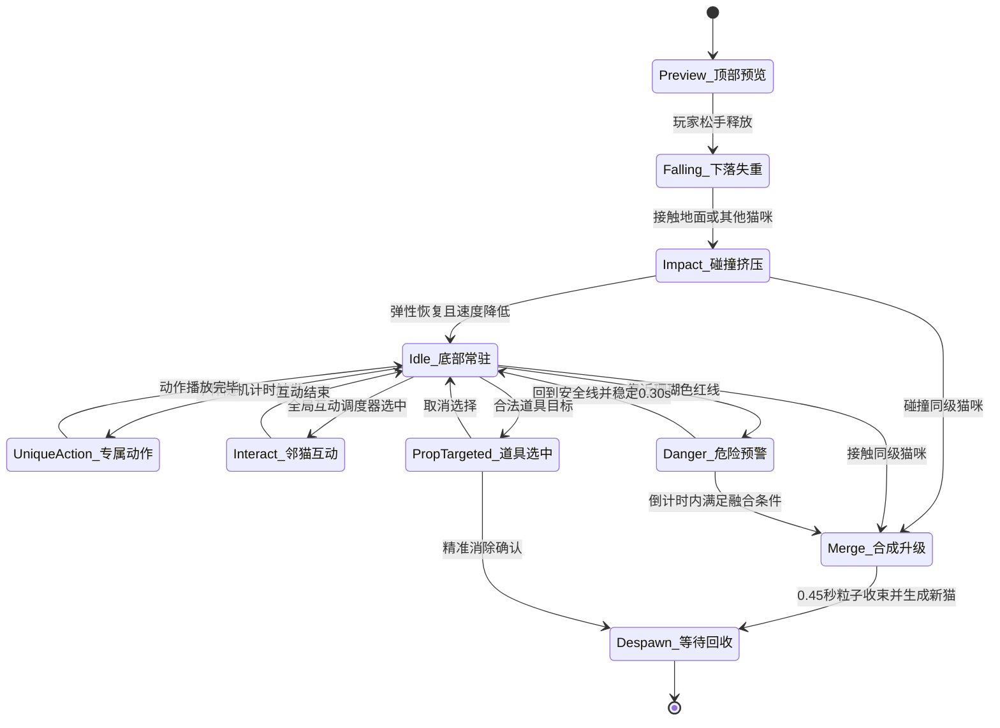
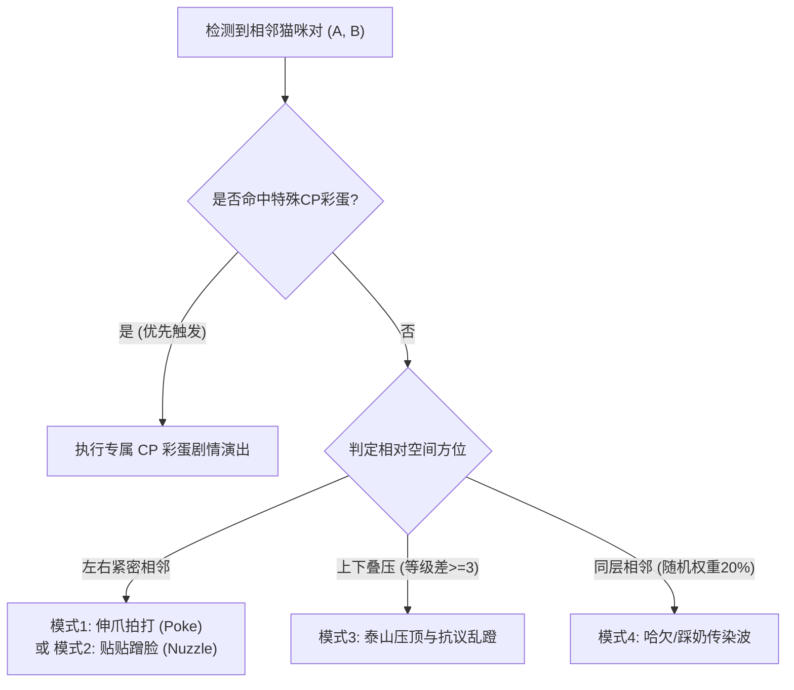
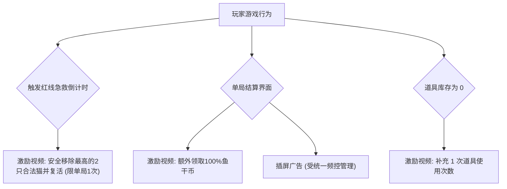
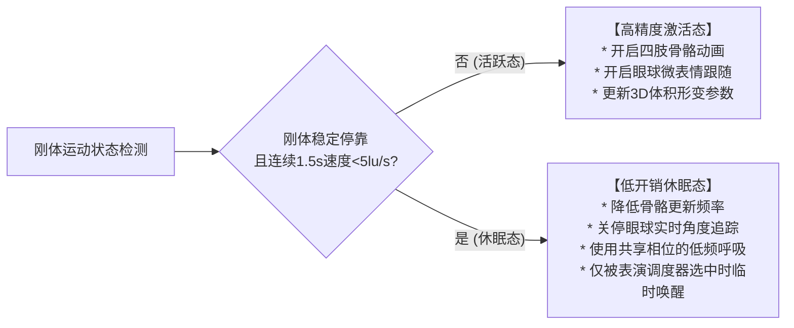

# 《猫咪团子》(Neko Dango) 全案游戏策划与技术设计规范（可制作验证版）

> **文档版本**：v2.2.0 (Production Validation Edition)  
> **项目代号**：Project-CatDango  
> **适用平台**：微信小游戏（首发） / 抖音小游戏 / H5 移动端 Web / 独立手游  
> **核心标签**：3D 猫咪团子 / 2.5D 受约束堆叠 / 软体果冻形变 / 云吸猫治愈 / 微表情状态机 / 策略合成  
> **文档定位**：本项目产品方向、玩法规则与技术验收的主规范。凡涉及概率、物理参数、广告接口和平台限制的内容，均需通过配置表、真机数据和发版前平台复核确认；未经验证的目标值不得作为已完成结论。
> **配套美术规范**：[《猫咪团子》3D 美术设计与资源清单](art/美术设计与资源清单_3D.md)

---

## 目录 (Table of Contents)
1. [项目定位与核心设计准则](#一项目定位与核心设计准则)
2. [核心玩法机制与游戏循环 (Core Loop)](#二核心玩法机制与游戏循环)
3. [11 阶猫咪全数值系统与几何空间拓扑验算](#三11-阶猫咪全数值系统与几何空间拓扑验算)
4. [果冻物理、四肢骨骼与五官挂点拆件规范](#四果冻物理四肢骨骼与五官挂点拆件规范)
5. [猫咪通用生命周期状态机 (Life-Cycle FSM)](#五猫咪通用生命周期状态机)
6. [Lv01–Lv11 专属动作、人设台词与音效库](#六lv01lv11-专属动作人设台词与音效库)
7. [底部“邻猫互动”系统与 CP 彩蛋矩阵](#七底部邻猫互动系统与-cp-彩蛋矩阵)
8. [四大道具系统、动作强反馈与时序互斥](#八四大道具系统动作强反馈与时序互斥)
9. [外围养成与长线留存系统 (Meta-Game)](#九外围养成与长线留存系统)
10. [商业化变现 (IAA) 与平台合规容灾体系](#十商业化变现-iaa-与平台合规容灾体系)
11. [视听音效工程与微信音频生命周期及静音策略](#十一视听音效工程与微信音频生命周期及静音策略)
12. [UI/UX 布局与多端折叠屏自适应规范](#十二uiux-布局与多端折叠屏自适应规范)
13. [极端边界容错、防穿模与原子并发控制](#十三极端边界容错防穿模与原子并发控制)
14. [前端渲染合批与休眠降级机制 (LOD & DrawCall)](#十四前端渲染合批与休眠降级机制)
15. [研发里程碑与验收路线图](#十五研发里程碑与验收路线图)
16. [数据埋点、调优与发布闸门](#十六数据埋点调优与发布闸门)

---

## 一、 项目定位与核心设计准则

### 1.1 核心体验与市场定位
* **破局痛点**：传统《合成大西瓜》类玩法依赖纯数值堆积，缺乏角色生命力，物体碰撞僵硬如硬塑料，容易产生“机械重复感”和“失败挫败感”。
* **核心卖点**：
  1. **Q 弹布丁软体手感**：通过 3D 体积近似守恒形变，实现“面团般可揉捏”的解压触感。
  2. **四肢生动独立可动**：打破传统刚体球的呆板，四肢、耳朵、胡须、配饰独立响应物理冲量与邻猫互动。
  3. **丰富微表情与邻里社交**：眼球动态追踪、被压扁的搞怪颜艺、相邻猫咪互相拍打/蹭脸的治愈感。
  4. **“云吸猫+庭院装扮”长线羁绊**：通过单局产出反哺外围猫窝建设，为 D7/D30 留存提供可测试的长期目标。

### 1.2 三大工程与策划铁律
1. **物理碰撞与视觉表现严格解耦**：
   * **物理层（Collider）**：每只猫使用标准球形碰撞体（Sphere Collider），刚体中心约束在 `Z=0` 玩法平面，仅允许 X/Y 平移与绕 Z 轴旋转。提高堆叠可预测性，并避免四肢或镜头角度改变碰撞结果。
   * **表现层（Visual Rig）**：完整 3D 身体、四肢、配饰和五官作为独立层级挂载，允许向碰撞球外延展 `10%~18%`，但绝不参与物理受力计算。
2. **三维体积近似守恒弹性法则（Squash & Stretch）**：
   * 以 $Scale_X \times Scale_Y \times Scale_Z \approx 1.0$ 为体积近似守恒基准；Y 轴压缩为 $s$ 时，默认 $Scale_X=Scale_Z=1/\sqrt{s}$。允许加强屏幕横向形变，但瞬时体积误差不得超过 `8%`。
3. **热闹而不嘈杂的声场秩序**：
   * 场上存在十几只猫咪时，由全局唯一的互动与音频调度器集中派发，同一时刻限制独白叫声，合成爽感优先级高于闲置叫声。

### 1.3 产品假设与首轮验证目标
* **核心用户**：偏好轻度合成、可爱角色与碎片化游玩的移动端用户；单次无压力游玩目标为 `4~8 分钟`，高手局可延长至 `15 分钟以上`。
* **MVP 成功条件**：玩家无需教程文字即可在 `20 秒` 内完成首次合成；首局能理解 Next、危险线与一次道具使用；失败原因可复述且不归因于随机“暗箱”。
* **首轮调优门槛**：至少采集 `200` 局内部/小规模测试数据，再冻结正式半径、掉落权重、危险倒计时与经济兑换比。
* **模式定位**：标准局为分数制无尽模式；首次生成 Lv11 视为本局里程碑而非强制结束，双 Lv11 触发终阶清场规则后可继续挑战高分。

---

## 二、 核心玩法机制与游戏循环 (Core Loop)

### 2.1 游戏基本规则
1. **容器环境**：标准竖屏下方的温馨编织大猫窝（透明高透视窗，底部带微圆弧，左右侧壁平滑）。有效容纳宽度为 `640lu`，警戒线位于容器底部上方 `660lu` 处。`lu` 为基于 750×1334 设计画布的逻辑单位，不等同于设备物理像素。
2. **操作与交互**：
   * **拖拽瞄准**：手指在投掷区横向拖拽，顶部投掷猫爪同步水平平移，底部投射细虚线落点参考与地面半透明投影光斑。
   * **松手释放**：猫爪松开，当前猫咪受重力加速掉落。`0.35s` 后允许展示并瞄准下一只猫，但只有当上一只猫首次发生有效碰撞，或释放后超过 `0.90s`，且全局不处于合成生成锁时，才允许再次释放。
   * **双胞胎预览 (Next Preview)**：顶部右侧常驻“下一个即将出现的猫咪”预览气泡，帮助高阶玩家预判堆叠策略。
3. **物理融合（Merge）**：
   * 任意两只**相同等级**的猫咪接触，且沿接触法线的相对速度 `< 80lu/s`、连续接触时间 `>= 50ms` 时触发融合。阈值必须配置化，避免高速擦碰误合成。
   * 经历 `0.45s` 的吸入、闪光、果冻爆裂回弹与冲击波扩散，在质心处生成高一等级的新猫。
   * **最高级封顶规则**：首次生成 Lv11 时触发“猫神降临”里程碑与拍立得收藏，但单局继续；两只 Lv11 满足融合条件时触发“满窝团圆”，两者在 `0.60s` 演出后同时消失，奖励 `4096` 分并释放一次弱清场波，不生成 Lv12。
4. **合成冲击波（Shockwave）安全约束**：
   * 新猫诞生时释放径向推力，推开周围物体，但**向上分量强制衰减至 30% 以下**。单体速度增量设置硬上限，危险线以上的对象不接受向上冲量，确保演出不会直接制造失败。
5. **连击机制 (Combo)**：
   * `1.2s` 内发生连续合成触发 Combo 计数，播放递增和弦音阶（Do-Mi-Sol-Do），连续 3 连击以上飘落猫薄荷粒子并给予阶梯式分数加成。
   * Combo 倍率按本次新生成猫的基础分计算：1 连 `×1.00`、2 连 `×1.15`、3 连 `×1.35`、4 连 `×1.60`、5 连及以上 `×2.00` 封顶。显示分数按四舍五入取整。
   * 每局首次达到 5 连击赠送 1 个魔法彩虹球；同局后续 5 连击改为奖励 `+200` 分，避免无限刷道具库存。
6. **警戒与失败判定 (Danger Line)**：
   * 猫窝顶部设有一条珊瑚粉色虚线 **“猫窝溢出警报线”**。
   * 判定统一采用**球形碰撞体世界包围盒的 Y 轴顶边**。猫咪必须已经发生首次有效碰撞并进入容器结算集合；Preview、Falling、Merge、Despawn 状态不参与越线计时。任意有效猫咪的顶边连续越过警戒线 `0.60s`，警报线由虚转实并触发 **3 秒急救倒计时**；不再要求刚体完全静止。
   * 越线对象全部回到安全线以下并持续 `0.30s` 后解除倒计时。倒计时期间允许瞄准和使用道具，但暂停新的投放释放；合成生成锁结束后立即重新采样高度。
   * 3 秒内未恢复安全状态，冻结物理世界并进入结算/复活流程。冻结之后产生的碰撞、合成和计分事件一律丢弃。

### 2.2 新手首局引导（总时长目标 <= 20s）
1. 首次进入只展示手势动画，引导左右拖动并松手；完成操作后立即消失，不使用阻断式长文本。
2. 首三只固定为 `Lv01、Lv01、Lv02`，引导玩家完成一次主动合成并观察 Next；该序列写入新手局随机种子，之后恢复标准概率池。
3. 危险线说明只在玩家首次进入 70% 高度时出现一次，并允许直接点击关闭；道具教学在首次真正需要救场时触发。
4. 引导可跳过、不会重复强制播放；所有关键规则在设置页提供图示回看。

### 2.3 核心循环全景图
```
                 ┌────────── 拖拽瞄准 (参考落点虚线) ──────────┐
                 │                                            │
                 ▼                                            │
          【选择投放位置】 (结合 Next 下一只猫策略)                 │
                 │                                            │
                 ▼                                            │
           【松手释放·果冻下坠】                                │ (单局持续游戏)
                 │                                            │
                 ▼                                            │
          【物理碰撞与软体挤压】                                 │
          /                  \                                │
       (同级相碰)          (异级堆叠)                          │
         /                      \                             │
        ▼                        ▼                            │
【触发连续Combo与坍缩】     【填补空隙·累积猫窝高度】───────────────┘
        │                        │
        ▼                        ▼
【炸出粒子+得分+鱼干币】      【触碰顶部珊瑚色红线】
        │                        │
        ▼                        ▼
【反哺外围猫窝装扮】         【3秒急救 / 激励视频复活(限1次)】
                                 │ (放弃复活)
                                 ▼
                         【战绩结算 & 拍立得相册】
```

---

## 三、 11 阶猫咪全数值系统与几何空间拓扑验算

### 3.1 终局几何拓扑深度严密验算
在合成类游戏中，终极物体（Lv11）的尺寸设计必须经过严格的解析几何验算，否则极易出现**“合成出第二只大猫瞬间因容器塞不下而直接暴毙”**的恶性体验：
* 本节计算的是 `Z=0` 玩法平面上的球体截面。由于所有动态刚体锁定深度轴，三维渲染不会改变这组二维堆叠关系。
* **容器物理参数**：容器有效宽度 $W = 640\text{lu}$，危险警戒线距离容器底部 $H_{danger} = 660\text{lu}$。
* **双终极猫交错堆叠极限公式**：
  两只半径为 $R$ 的圆，当两圆同时与侧壁相切并互相紧密相贴时，水平中心距达到最大值：
  $$\Delta x = W - 2R$$
  两球相切中心距为 $D = 2R$。此时产生的垂直中心距为：
  $$\Delta y = \sqrt{(2R)^2 - (W - 2R)^2} = \sqrt{4WR - W^2}$$
  此时双大猫堆叠的总高度为：
  $$H_{stack} = 2R + \sqrt{4WR - W^2}$$
* **反推安全半径阈值**：
  要求物理包围高度 $H_{stack} \le 630\text{lu}$（相对 660lu 危险线保留至少 30lu 静态裕量）：
  * 若 $R = 205\text{lu}$：$\Delta x = 230\text{lu}$，$\Delta y = \sqrt{410^2 - 230^2} \approx 339.4\text{lu}$，$H_{stack} = 205 \times 2 + 339.4 = 749.4\text{lu} \gg 660\text{lu}$（**必然超线暴死！**）。
  * 若 $R = 188\text{lu}$：$H_{stack} \approx 643.7\text{lu}$，虽低于危险线，但**不满足 630lu 的安全目标**，仅剩 16.3lu 裕量，不能作为量产参数。
  * 解方程 $2R + \sqrt{4WR-W^2}=630$，得到临界值约 $R=186\text{lu}$。量产初值采用 **$R=180\text{lu}$**：$\Delta x=280\text{lu}$，$\Delta y\approx226.3\text{lu}$，$H_{stack}\approx586.3\text{lu}$，保留约 73.7lu 的物理裕量。
  * Lv09~Lv11 在竖直和深度方向的视觉外延限制为物理半径的 `12%`，屏幕横向可放宽至 `18%`；接近危险线时，装饰粒子与皇冠不参与失败判定，并自动向安全区偏移或裁切。

### 3.2 优化校准后的全数值体系表

| 等级 | 猫咪品种/名称 | 建议物理半径 ($R$) | 物理质量 ($M$) | 弹性 ($e$) | 生成基础分 | 图鉴体重（仅展示） | 解锁图鉴台词 |
| :---: | :--- | :---: | :---: | :---: | :---: | :---: | :--- |
| **Lv 01** | **奶萌毛线球** | `26 lu` | 1.0 | 0.45 | 0（投放物） | 0.2 kg | “别扯我身上的蓝毛线，会散架哒~” |
| **Lv 02** | **奶牛小毛团** | `34 lu` | 1.5 | 0.42 | +2 | 0.5 kg | “黑白配，快乐翻倍！今天也要踩奶！” |
| **Lv 03** | **软萌布偶猫** | `44 lu` | 2.3 | 0.38 | +4 | 1.2 kg | “只要我歪一歪头，小鱼干就会自己飞过来。” |
| **Lv 04** | **贪睡三花猫** | `56 lu` | 3.5 | 0.35 | +8 | 2.5 kg | “呼噜……再睡五分钟，梦里全是大罐头……” |
| **Lv 05** | **傲娇美短猫** | `70 lu` | 5.2 | 0.32 | +16 | 4.2 kg | “哼，这条小鱼干才不是留给你的！” |
| **Lv 06** | **呆萌暹罗猫** | `86 lu` | 7.5 | 0.28 | +32 | 6.8 kg | “咦？左边的我和右边的我，哪个更黑一点？” |
| **Lv 07** | **黑猫巡逻长** | `104 lu` | 10.5 | 0.25 | +64 | 10.5 kg | “报告！猫窝秩序良好，未发现偷吃嫌疑喵！” |
| **Lv 08** | **肥美英短蓝猫** | `124 lu` | 14.5 | 0.22 | +128 | 15.0 kg | “别催我减肥，这叫饱满的智慧。” |
| **Lv 09** | **大橘为重** | `146 lu` | 19.5 | 0.18 | +256 | 21.0 kg | “不是我胖，是猫窝显小。” |
| **Lv 10** | **软糯白狮大猫** | `166 lu` | 26.0 | 0.15 | +512 | 32.0 kg | “陷进我的云朵鬃毛里，烦恼都会消失哦。” |
| **Lv 11** | **宇宙究极黄金巨猫** | `180 lu` | 35.0 | 0.10 | +1024 | 50.0 kg | “满窝星光闪耀，全宇宙的猫咪都为你祝福！” |

> **计分口径**：表中分数为“生成该等级”时获得的基础分；投放 Lv01 不计分。Combo 在基础分结算后乘算。双 Lv11“满窝团圆”固定奖励 4096 分，不再套用普通等级公式。

### 3.3 自适应动态掉落概率池
为防止游戏后期大猫缝隙卡死小猫，掉落概率根据当前场上猫咪堆叠总高度动态调整：

`堆叠高度比例 = 最高有效猫咪 AABB 顶边距容器底部的高度 / 660lu`。仅统计已经发生首次有效碰撞且不处于 Merge/Despawn 的实体；单帧尖峰不切换概率阶段，跨阈值持续 `0.50s` 后生效，并设置 `3%` 回差避免频繁抖动。

| 场上堆叠状态 | Lv01 (毛线球) | Lv02 (奶牛球) | Lv03 (布偶猫) | Lv04 (三花猫) | Lv05及以上 | 防脸黑保底规则 |
| :--- | :---: | :---: | :---: | :---: | :---: | :--- |
| **初始阶段** (高度 < 40%) | 40% | 35% | 20% | 5% | 0% | 连续出现同一级别不超过 3 次 |
| **中盘阶段** (高度 40%~65%) | 30% | 35% | 25% | 10% | 0% | 连续同级不超过 3 次 |
| **高危阶段** (高度 > 65%) | 20% | 30% | 35% | 15% | 0% | 压低超小号球概率，防止卡缝堵死 |

* 每局开始时生成随机种子，所有掉落结果可复现并写入回放日志；Next 在当前猫投放时即固定，不因玩家移动位置而改变。
* 系统不得根据落点或付费行为“定向发牌”。仅当连续 `8` 次投放都未出现可在场上配对的 Lv01~Lv04 时，允许触发一次公开的“幸运毛球”保底：把下一只替换为场上已有的最低等级之一，并在 Next 气泡显示幸运标记。

### 3.4 首轮数值验证指标（调优目标，非上线承诺）
| 指标 | 目标区间 | 超界处理 |
| :--- | :---: | :--- |
| 首次合成时间 | `5~20s` | 检查教学、初始掉落和操作反馈 |
| 首次生成 Lv05 | `2~4min` | 调整前中盘掉落权重与释放节奏 |
| 普通玩家单局中位时长 | `4~8min` | 调整危险线、倒计时和容器密度 |
| 熟练玩家首次 Lv11 | `10~18min` | 调整半径曲线、Combo 与保底触发率 |
| 非操作性死亡占比 | `<5%` | 回放定位冲击波、穿模和倒计时误判 |

---

## 四、 果冻物理、四肢骨骼与五官挂点拆件规范

### 4.1 果冻软体算法（Squash & Stretch）与局部挂点绑定
1. **碰撞形变阻尼振子模型**：
   * 当碰撞速度 $v_{impact} > v_{threshold}$ 时，计算初始压缩量 $s = \min(v_{impact} \times \alpha, 0.22)$。
   * 轴向压缩：$Scale_{axial} = 1.0 - s$；另外两个轴的对称补偿为 $Scale_{cross}=1/\sqrt{Scale_{axial}}$。需要强调屏幕横向时，可在保持三轴乘积误差不超过 `8%` 的前提下重新分配 X/Z 补偿。
   * 在 `0.35s` 内通过二阶欠阻尼曲线恢复基准尺寸。
2. **面部中心挂点绑定（Face Anchor）**：
   * **核心规范**：眼睛、嘴巴、胡须等面部组件，必须挂载于以 `(0.5, 0.45)` 为基准的独立 `face_anchor` 挂点上，而非刚体根节点。在身体发生挤压形变时，`face_anchor` 仅接收 50% 的形变权重，防止五官被拉扯飞出猫咪脸部外边缘。

### 4.2 单只猫咪标准图层切件规范（Z-Order 统一）

| 层级 (Z) | 部件名称 | 命名规范 | 锚点 (Pivot) | 动效与驱动说明 |
| :---: | :--- | :--- | :---: | :--- |
| **0** | **软垫阴影** | `shadow` | `(0.5, 0.5)` | 仅在顶部预览与地面附着时显示，随身体宽度实时拉伸 |
| **1** | **尾巴** | `tail` | `(0.5, 0.2)` | 待机与兴奋时正弦轻摆（`±15°`） |
| **2** | **左/右后脚** | `foot_l` / `foot_r` | `(0.5, 0.8)` | 下落悬空时蹬腿，侧翻倒立时乱蹬，亮出粉色肉垫 |
| **3** | **身体底座** | `body_base` | `(0.5, 0.15)` | 抹除五官的纯净果冻底座，承载全身体积形变与呼吸缩放 |
| **4** | **左/右耳朵** | `ear_l` / `ear_r` | `(0.5, 0.1)` | 下落失重时压成飞机耳，惊吓时警觉立起 |
| **5** | **面部腮红** | `blush` | `(0.5, 0.5)` | 贴贴或同级靠近时透明度淡入并微幅放大 |
| **6** | **眼睛组件** | `eyes_*` | `(0.5, 0.5)` | 包含 `normal`（常态/跟随）、`blink`（笑眼）、`shock`（受惊）、`squash`（挤扁 `><` 或蚊香眼 `@ @`） |
| **7** | **嘴巴组件** | `mouth_*` | `(0.5, 0.5)` | 包含 `normal`（抿嘴）、`meow`（张嘴喵）、`sleep`（呼噜小嘴） |
| **8** | **左/右前爪** | `paw_l` / `paw_r` | `(0.5, 0.85)` | **核心可动件**：负责向邻猫伸爪拍打、捧鱼干、揉肚皮、踩奶 |
| **9** | **肉垫翻转爪** | `paw_pad_l/r` | `(0.5, 0.8)` | 受惊翻倒或合成登场欢呼时替换显示粉嫩肉垫 |
| **10** | **专属独立配饰**| `prop_*` | 按件设定 | 各等级独有挂件（巡逻帽、皇冠、鱼干、鼻涕泡等） |

### 4.3 Lv01–Lv11 特殊配饰挂点表
* **Lv01 奶萌毛线球**：`prop_yarn_bow`（斜挎蝴蝶结毛线绒球，支持独立摆动）
* **Lv02 奶牛小毛团**：`prop_hair_curl`（头顶奶油卷毛，随跳跃轻弹）
* **Lv03 软萌布偶猫**：`prop_hair_curl`（额前卷毛）+ `mouth_tongue`（粉色小舌头）
* **Lv04 贪睡三花猫**：`prop_snot_bubble`（鼻尖半透明鼻涕泡，支持呼吸缩放与破裂）
* **Lv05 傲娇美短猫**：`prop_dried_fish`（小鱼干，支持叼在嘴里与双爪捧着啃）
* **Lv06 呆萌暹罗猫**：`eyes_cross`（支持左右独立偏移的蓝色斗鸡眼珠）+ `eyes_dizzy`
* **Lv07 黑猫巡逻长**：`prop_patrol_hat`（黑金巡逻帽，支持扶帽、歪帽、受惊震浮）
* **Lv08 肥美英短蓝猫**：`prop_whiskers`（白胡须）+ 腮帮子多层果冻抖动节点
* **Lv09 大橘为重**：`prop_belly_fur`（奶油白大肚腩，支持独立拍肚皮弹颤）
* **Lv10 软糯白狮大猫**：`prop_mane_outer`（外圈蓬松云朵狮鬃，支持抖毛扩散波）
* **Lv11 宇宙黄金巨猫**：`prop_gold_crown`（发光小皇冠）+ `prop_star_sparkles`（周身星光闪耀层）

---

## 五、 猫咪通用生命周期状态机

每只猫咪从生成到回收使用同一套显式状态；暂停、道具选取和结算由全局局面状态控制，禁止仅靠多个布尔值叠加：



### 5.1 全局局面状态（Game Flow）
`Boot -> Tutorial/Ready -> Playing -> DangerCountdown -> ReviveOffer -> Playing 或 Result -> Meta`。`Paused` 可从 Playing/DangerCountdown 进入并原样返回；进入 `ReviveOffer` 或 `Result` 前必须冻结物理步进、投放输入、计分事件和互动调度。广告返回后只能通过一次性事务恢复，避免重复复活。

### 5.2 `Preview` 顶部预览待机（下落前）
* **身体表现**：周期 `1.6s` 的微幅呼吸，三轴联动且体积近似不变；呼吸幅度不超过基准体积的 `2%`。
* **四肢动作**：两只前爪交替微幅摆动（`±8°`），双后脚自然下垂。
* **跟随与眼球**：手指滑动时，身体呈现反向惯性倾斜（最大 `±10°`）；眼球始终注视猫窝底部的空隙，极具灵性。

### 5.3 `Falling` 下落失重态
* **身体表现**：受重力加速，纵向微拉伸（参考 `ScaleX: 0.96, ScaleY: 1.08, ScaleZ: 0.96`）。
* **四肢动作**：四爪张开，两前爪高频小幅扑腾（`0.12s/次`，`±12°`），双耳向后压成飞机耳。
* **配饰状态**：巡逻帽/皇冠因风阻向上浮动 `3~5lu`。

### 5.4 `Impact` 落地/受撞挤压态
* **形变曲线**：
  * `0.00s ~ 0.08s`：沿碰撞法线瞬间压扁（正面落地参考 `ScaleX: 1.22, ScaleY: 0.78, ScaleZ: 1.05`；三轴乘积约为 1）。
  * `0.08s ~ 0.22s`：反弹拉伸（参考 `ScaleX: 0.96, ScaleY: 1.08, ScaleZ: 0.96`）。
  * `0.22s ~ 0.35s`：阻尼回归基准尺寸。
* **四肢与表情**：前爪摊平贴地，表情秒切三视图底部的**压扁眯眼态（`><` 或蚊香眼 `@ @`）**并维持 `0.35s`。

### 5.5 `Idle` 底部常驻态
* **基准待机**：刚体线速度 `< 5lu/s` 进入常驻。慢速呼吸（周期 `2.2s`），每 `3~5s` 自然眨眼一次。
* **翻车检测**：若倾角 `> 45°`（侧翻或倒立），后脚与前爪偶尔轻微蹬动两下，模拟“太胖翻不过身”的呆萌神态。

### 5.6 `Merge` 合成聚变升级态
* **坍缩吸入（0.00s ~ 0.15s）**：两猫关闭碰撞，朝质心收缩并压扁。
* **白光爆发（0.15s ~ 0.18s）**：中心爆发直径 80lu 星芒遮挡贴图切换。
* **新猫登场（0.18s ~ 0.45s）**：新猫以 `Scale 0.4` 结合 `Cubic.easeOutBack` 爆发放大，摆出**后仰亮出粉色肉垫 + 开心欢呼姿态**持续 `0.45s`。
* **定向冲击波与粒子**：释放衰减的径向冲击波（向上推力衰减 70%），向四周散落 8~12 颗肉垫、小鱼干和星星粒子。

### 5.7 `Danger` 危险线预警态
* **表现**：最高处的 1~2 只猫咪切换为 `shock` 瞪圆眼表情，双爪拼命向上挥舞抓取平衡，头顶冒出汗滴气泡；珊瑚色红线温和呼吸闪烁，配合轻微心跳声。

---

## 六、 Lv01–Lv11 专属动作、人设台词与音效库

专属动作不再由每只猫独立计时。全局 `CatPerformanceDirector` 每隔 `2.5~4.0s` 从稳定 Idle 猫中选择 **1 只**播放专属性格动作（耗时 `1.0~1.8s`），并遵守：同屏最多 1 个主动作、3 个低成本呼吸/眨眼；合成、危险倒计时和道具演出拥有抢占权；独白叫声冷却不少于 `4s`。开启“减少动态效果”后，取消大幅旋转、全屏粒子和连续摇摆，仅保留表情切换与轻微缩放。

### 🧶 Lv01 奶萌毛线球
* **专属动作【拨弄毛线结】**：左爪抬起，右爪抱住右侧蓝色蝴蝶结绒球连续拨弄两下（绒球钟摆晃动 `±18°`），随后身体向下趴扁成笑眼 `^ ^` 趴趴态。
* **专属叫声**：极细软清脆的幼猫奶音 *“咪呀~”*（时长 `0.35s`）。

### 🐄 Lv02 奶牛小毛团
* **专属动作【快乐踩奶操】**：保持弯月笑眼，双前爪以 `0.2s` 周期交替上下揉面团（循环 3 次），身体左右摇摆（`±6°`），头顶奶油卷毛轻弹。
* **专属叫声**：轻快短促的双连音 *“喵呜！”*（时长 `0.4s`）。

### 🎀 Lv03 软萌布偶猫
* **专属动作【歪头舔爪洗脸】**：身体向右微倾 `10°` 歪头杀，吐出粉色小舌头，右前爪在嘴边擦拭洗脸 2 次，偶尔向后微仰亮出肉垫挥舞。
* **专属叫声**：甜美粘人、尾音上扬的撒娇音 *“喵~唔~”*（时长 `0.55s`）。

### 💤 Lv04 贪睡三花猫
* **专属动作【吹鼻涕泡与说梦话】**：熟睡呼吸，鼻涕泡从 `Scale 0.4` 吹大至 `1.3`；四肢轻微抽搐蹬动，鼻涕泡 *“啵”* 地破裂，短暂惊醒揉眼后秒睡。
* **专属叫声**：轻柔呼噜声 *“Purr... 呼噜~”*，破裂时带迷糊的 *“喵？”*。

### 🐟 Lv05 傲娇美短猫
* **专属动作【捧鱼干偷啃】**：双前爪迅速抬起捧住嘴角的小鱼干，眼睛切换为幸福笑眼，双爪快速晃动啃咬两口，随后高冷拭嘴装作若无其事。
* **专属叫声**：傲娇护食鼻音 *“哼喵~（嚼嚼）”*（时长 `0.45s`）。

### 👀 Lv06 呆萌暹罗猫
* **专属动作【斗鸡眼对焦与挠头】**：两颗蓝眼珠向中间靠拢盯着鼻尖成极致斗鸡眼（`0.5s`），随后眼珠转成蚊香眼 `@ @`，黑前爪挠挠头顶。
* **专属叫声**：疑惑上扬的呆萌音 *“喵嗷？”*（时长 `0.4s`）。

### 🚓 Lv07 黑猫巡逻长
* **专属动作【扶正巡逻帽与认真敬礼】**：身体压低进入警戒态（耳边冒感叹号），左右扫视一圈后立正挺胸，右爪利落抬到帽檐敬礼，帽徽反光。
* **专属叫声**：中气十足、干脆利落的立正音 *“喵！（收到）”*（时长 `0.3s`）。

### 🛋️ Lv08 肥美英短蓝猫
* **专属动作【揉肥肚与揣手化饼】**：圆滚滚的灰爪在肚皮上画圈揉肚肚，接着长叹一口气把爪子往身底下一揣（农民揣），整只猫瘫软成一张宽宽的灰毛饼。
* **专属叫声**：慵懒低沉的大叔音 *“喵……呜……”*（时长 `0.65s`）。

### 🍊 Lv09 大橘为重
* **专属动作【拍大肚腩震动波】**：满脸富态微笑，左右爪交替拍打雪白大肚腩，肚皮产生明显 Q 弹水波纹振荡（`Scale 1.06 -> 0.96 -> 1.0`），后脚惬意微晃。
* **专属叫声**：浑厚圆润带共鸣的满足音 *“喵嗷~”*（时长 `0.6s`）。

### 🦁 Lv10 软糯白狮大猫
* **专属动作【抖动云朵鬃毛与反差睁眼】**：全身蓬松白云鬃毛像小狗甩水般左右快速抖动一圈，随后**突然睁开清澈透亮的蓝宝石大眼睛**眨巴两下，又重新闭目微笑。
* **专属叫声**：温柔绵长的小狮子哈欠奶音 *“哈~喵呜~”*（时长 `0.7s`）。

### 👑 Lv11 宇宙究极黄金巨猫
* **专属动作【托举皇冠与星光赐福】**：双爪向上轻轻扶正发光小皇冠，身体后仰露出肉垫开怀大笑，周身金星闪耀，飘散出柔和暖金粒子。
* **专属叫声**：带有风铃泛音与殿堂混响的治愈大喵声 *“喵~✨（叮当风铃音）”*（时长 `0.8s`）。

---

## 七、 底部“邻猫互动”系统与 CP 彩蛋矩阵

### 7.1 全局互动调度器 (CatInteractionManager) 运作准则
1. **候选检测**：稳定停靠（速度 `< 5lu/s`）超过 `1.5s`，计算两圆心距离 $D \le R_A + R_B + 18\text{lu}$，确认相邻对。
2. **频率与频次约束**：每隔 `5.0s ~ 8.0s` 最多触发 **1 组** 互动，且必须取得 `CatPerformanceDirector` 的主动作令牌；同一时刻全场仅限 **1 组** 播放猫叫声。
3. **连击避让**：当玩家处于快速连续合成时，闲置互动声音自动降低 40% 音量，将听觉让位给合成打击感。

### 7.2 四种方向感知通用互动模式



* **模式 1：伸爪拍打（Poke & Pat）**：发起方根据方位向邻居伸出前爪（超出边界 14lu）轻轻拍打脸颊 2 次，受击方产生小果冻形变并回叫一声。
* **模式 2：贴贴蹭脸（Soft Nuzzle）**：双方切换为腮红加深的眯眯笑眼，相向倾斜 `8°` 互相揉蹭，交界处飘出粉色小心心气泡。
* **模式 3：泰山压顶（Heavy Squash）**：大猫（Lv8~10）压在幼猫（Lv1~4）头顶时，大猫惬意下沉揉肚，底下的幼猫压成扁饼（`><` 表情）并手忙脚乱乱蹬抗议。
* **模式 4：哈欠传染链（Contagious Mood）**：一只猫打哈欠或踩奶，延迟 `0.6s` 传染给邻猫同步打哈欠，形成治愈波动。

### 7.3 八组专属角色 CP 彩蛋互动剧情

| 编号 | 组合角色 A | 组合角色 B | 剧情名称 | 专属演出与视觉细节 | 音效与气泡 |
| :---: | :--- | :--- | :--- | :--- | :--- |
| **CP 01** | **Lv07 黑猫巡逻长** | **Lv05 傲娇美短猫** | **巡查私藏鱼干** | 巡逻长压低身子扶正帽子认真查看；美短双爪护住鱼干，紧张地眨眼。 | 巡逻长立正音 + 感叹号气泡；美短护食哼叫 |
| **CP 02** | **Lv01 奶萌毛线球** | **Lv02 奶牛 / Lv03 布偶** | **猫猫爱玩球** | 奶牛或布偶伸爪去拨弄毛线球的蓝色蝴蝶结；毛线球害羞地骨碌碌转了半圈。 | 欢快双猫合鸣 + 音符气泡 `♪` |
| **CP 03** | **Lv04 贪睡三花猫** | **任意相邻猫咪** | **戳破鼻涕泡** | 三花猫吹出大鼻涕泡，旁边的邻猫好奇伸爪 *“啵”* 地戳破；三花猫惊醒挥爪。 | 气泡破裂音 + 三花惊醒叫 *“喵？！”* |
| **CP 04** | **Lv08 肥美英短蓝猫** | **Lv09 大橘为重** | **重量级肚皮对撞**| 两只大胖猫圆滚滚的肚腩互相顶撞一下（强果冻回弹），双双揣手手互叹一口气。 | 低沉双重叹息喵 + 水波纹震荡 |
| **CP 05** | **Lv06 呆萌暹罗猫** | **Lv06 呆萌暹罗猫** | **同步照镜子** | 隔空相邻时，两只挖煤脸互相贴近，同时做出极致斗鸡眼与歪头。 | 呆萌疑问音 *“喵？”* + 问号气泡 `?` |
| **CP 06** | **Lv05 傲娇美短猫** | **Lv09 大橘为重** | **贪吃橘盯鱼干** | 大橘凑近美短嘴角流口水；美短傲娇把脸扭向一侧，单爪把鱼干往嘴里塞了塞。 | 大橘吞口水声 + 美短傲娇 *“哼！”* |
| **CP 07** | **Lv10 软糯白狮大猫** | **Lv01~Lv04 幼猫** | **云朵妈妈抱抱** | 白狮大猫温柔抖动鬃毛，伸出大白爪摸摸小猫头；小猫舒服得趴扁成小年糕。 | 温暖轻柔呼噜声 + 小太阳气泡 |
| **CP 08** | **Lv11 黄金巨猫** | **全场相邻猫咪** | **究极猫神赐福** | 巨猫托举皇冠星光绽放，所有相邻猫咪齐刷刷后仰亮出粉肉垫做朝拜挥爪。 | 神圣风铃泛音 + 满堂软萌大合唱 |

---

## 八、 四大道具系统、动作强反馈与时序互斥

### 8.1 道具属性与交互全量表

| 道具名称 | 视觉与动作表现 | 核心功能规则 | 获取途径（合规设计） |
| :---: | :--- | :--- | :--- |
| **🪶 逗猫棒 (Teaser)** | 金色羽毛在上方轻快划过，全场猫咪齐刷刷抬头挥爪追随；随后施加持续 `1.2s` 的有上限垂直微冲量 | **震动重排**：打破堆叠形成的悬空缝隙，促使自然下沉对齐；容器壁保持刚性固定，防穿模 | 每日首次免费签到 / 鱼干币兑换 / 看激励视频 |
| **🐟 香酥鱼干 (Cat Treat)** | 点选指定猫咪，一块香脆烤鱼干落下，猫咪捧着鱼干露出满足笑脸，开心地扑腾飞出屏幕 | **精准消除**：点选消除场上任意一只阻碍合成的小中型猫咪（Lv01~Lv06） | 观看激励视频 / 猫窝成就达成赠送 |
| **🌈 魔法彩虹球 (Wild)** | 一团带有七彩拖尾的毛线球；接触任意猫咪，该猫惊喜抱球旋转一圈升一级 | **万能合成**：落地首次有效接触 Lv01~Lv10 时，将其升级一级；接触 Lv11 时不消费道具并弹出“已是最高级”提示 | 连续达成 5 连击 (Combo) 奖励 / 激励视频补给 |
| **💨 猫咪吹风机 (Blower)** | 粉色暖风从侧下方吹起，全窝猫咪耳毛偏斜、眯起眼睛 `><` 抱头，被轻柔托起浮空 `1.5s` | **低位浮空洗牌**：托起下层 30% 猫咪，让上层小猫自然滑落至底部重新对齐 | 每日开局赠送 1 次 / 鱼干币购买 |

### 8.2 道具生效时序与状态互斥
* **瞬态安全锁**：
  * 当香酥鱼干进入选猫模式时，凡是处于 `isMerging = true`（合成融合吸附中）的猫咪打上灰色不可选蒙版，禁止点选。
  * 逗猫棒和吹风机释放的浮动力场，自动忽略正在执行合体爆发动画的瞬态节点，避免因对象销毁产生 `NullPointer` 报错。
  * 道具统一经过 `Idle -> Targeting -> Confirmed -> Resolving -> Cooldown` 流程。进入 Targeting 暂停投放但不暂停物理；进入 Resolving 后锁定其他道具，直到所有受影响对象完成结算。
  * 危险倒计时期间仅允许使用香酥鱼干与逗猫棒；吹风机和彩虹球置灰，避免扩大越线范围或产生新的落点歧义。道具演出不暂停倒计时，但有效消除/沉降可以解除倒计时。

---

## 九、 外围养成与长线留存系统 (Meta-Game)

纯粹的合成生命周期有限，因此以轻度放置与装扮养成验证 D1、D7 与 D30 留存改善；是否有效以分群数据为准：

### 9.1 “温馨猫窝”庭院装扮系统
* **货币命名**：外围软货币统一称为 **“鱼干币”**，与局内道具“香酥鱼干”区分。
* **货币结算**：每局基础鱼干币为 `max(1, floor(有效分数 / 100))`；有效分数不包含装扮加成，单局基础产出设置配置上限。观看结算激励视频可领取额外 `+100%`，不采用 3 倍，降低经济膨胀与“不看广告亏损”感。
* **个性化定制内容**：
  * **猫窝款式**：经典编织竹篮、温暖日式暖桌、粉嫩草莓纸箱、星际太空舱。
  * **背景地毯**：针织毛线毯、樱花落叶垫、奶酪薄饼垫。
  * **挂件与玩具**：挂墙猫爬架、飘动的小风铃、窗台绿植。
* **收集奖励**：装扮只改变视觉与拍立得背景，不影响标准局分数和排行榜公平性；首次集齐主题一次性奖励鱼干币、头像框或表情。

| 消耗项 | 首轮价格带 | 目标节奏 |
| :--- | :---: | :--- |
| 小型挂件/玩具 | `100~300` 鱼干币 | 新玩家首日可解锁 1~2 件 |
| 背景地毯 | `500~900` 鱼干币 | `2~4` 天自然获取 |
| 完整猫窝主题 | `1500~2500` 鱼干币 | `7~14` 天自然获取 |
| 单次局内道具 | `60~120` 鱼干币 | 不鼓励每局常态购买 |

> 以上价格是封测初值。正式冻结前必须用“每日局数 × 单局中位产出 + 离线产出”验证，目标是非广告玩家首日也能完成一次有意义的装扮选择。

### 9.2 离线猫粮（挂机放置产出）
* 玩家解锁的最高等级猫咪决定每小时鱼干币产出，最多累积 8 小时；Lv01 初值 `2/h`，每提升一级约增长 `25%~35%`，Lv11 上限不超过 `40/h`。
* 离线产出计时使用服务端时间；离线或弱网时可暂存本地待校验记录，禁止直接信任客户端修改后的系统时间。
* **召回机制**：仅在平台当前规则允许时，以非奖励、可关闭的方式说明“添加到我的小程序”可便捷回访；不得承诺添加、分享或拉人后获得游戏资源。

### 9.3 每日残局关卡 (Daily Puzzle Challenge)
* 每个自然日按服务端日期从已验收题库中轮换一局固定布局（如：“30 步内合成布偶猫”、“解救被毛线箱卡住的美短”），不要求运营团队每天手工制作新关。
* 通关每日挑战可获得专属相框印章与特殊称号，并在朋友圈/群内展示独一无二的解谜步数成绩。
* 首发至少准备 `21` 个经自动求解器验证可通关的残局；相同题目在 `30` 天内不重复。排行榜记录关卡版本、随机种子、步数与道具使用情况。

---

## 十、 商业化变现 (IAA) 与平台合规容灾体系

### 10.1 微信首发合规基线（提审前必须复核）
1. **严禁诱导分享**：严禁出现“分享到微信群才能领取道具/复活”的设计。所有奖励道具仅通过游戏内成就、鱼干币或玩家主动选择的激励视频获得。
2. **纯自发拍立得相册**：
   * 合成新猫时，生成复古拍立得相框（包含猫咪搞怪自拍照、体重评语与防伪印章）。
   * 界面仅提供“保存相册”与合规的系统原生“分享好友（`wx.shareAppMessage`）”，不作任何强制通关门槛。

### 10.2 广告变现矩阵（IAA 商业模型）



* **激励视频**：仅由玩家主动点击触发；按钮旁提前写明奖励内容。未完整观看不得发放常规奖励。
* **插屏广告**：新用户前 `3` 局不展示；两次插屏间隔不少于 `180s`；默认每日最多 `3` 次，并通过远程配置下调。插屏只出现在完整结算后，不打断投放、危险倒计时或收藏演出。
* **复活原子性**：复活时从未处于 Merge/Despawn 状态的猫中，按 AABB 顶边高度稳定排序，移除最高两只；同高时按实体 ID 决定，保证回放一致。完成移除后将剩余刚体速度清零，等待 `0.30s` 再恢复输入。

### 10.3 微信广告拉取失败容灾降级（Failover Policy）
真机运行中常出现“1004 无广告”、“1005 广告拉取超时”等网络异常，必须设置兜底体验：
```javascript
// 激励视频安全播放封装（伪代码；发版前按当前平台 API 复核）
function showSafeRewardedVideo(adUnitId, grantReward, showNoFillHint) {
  const ad = getOrCreateRewardedVideoAd(adUnitId);
  let settled = false;

  const onClose = (result) => {
    if (settled) return;
    settled = true;
    ad.offClose(onClose);
    if (result && result.isEnded === true) {
      grantReward(createRewardTxnId()); // 业务层按流水号保证幂等
    } else {
      wx.showToast({ title: '完整观看后才能领取奖励', icon: 'none' });
    }
  };

  ad.onClose(onClose);
  ad.show().catch(() => {
    if (settled) return;
    settled = true;
    ad.offClose(onClose);
    showNoFillHint();
    // 广告无填充只记录“爱心补给”资格：每账号每日最多1次，
    // 不在每次失败时无限免费发奖。
    offerDailyMercyRewardIfEligible();
  });
}
```

### 10.4 多平台能力隔离
玩法层禁止直接调用 `wx.*`、抖音或原生 SDK。统一通过 `PlatformAdapter` 暴露 `showRewardedAd`、`showInterstitial`、`shareSnapshot`、`storage`、`audioLifecycle` 与 `safeArea`；不支持的能力返回明确结果并隐藏对应入口，不以空实现假装成功。每个平台单独维护广告频控、生命周期和隐私声明测试用例。

---

## 十一、 视听音效工程与微信音频生命周期及静音策略

### 11.1 微信音频生命周期与静音偏好
```javascript
// 全局启动初始化
wx.setInnerAudioOption({
  mixWithOther: true,
  obeyMuteSwitch: true // 默认尊重系统静音；用户可在设置中单独关闭游戏音效/音乐
});

// 处理系统来电打断与微信切后台
wx.onAudioInterruptionBegin(() => {
  AudioManager.pauseAll();
});
wx.onAudioInterruptionEnd(() => {
  AudioManager.resumeBGMIfPreviouslyPlaying();
});
wx.onHide(() => {
  AudioManager.pauseAll();
});
wx.onShow(() => {
  AudioManager.resumeBGMIfPreviouslyPlaying();
});
```

* 首次启动不得主动弹出索要声音权限或强制发声；音乐、音效、触觉反馈提供独立开关并持久化。
* “减少动态效果”开启时同步关闭连续震动与高频闪光；危险状态只在进入倒计时和最后 1 秒各触发一次轻震，不做周期无限震动。

### 11.2 核心音效与振动配表

| 音效 ID | 触发时机 | 音效风格描述 | 动态 Pitch 范围 | 触觉震动反馈 (`wx.vibrateShort`) |
| :--- | :--- | :--- | :---: | :--- |
| `sfx_drop` | 松手释放猫咪 | 柔和的空气呼啸声 | `0.95 ~ 1.05` | 无 |
| `sfx_bounce_soft` | 落地/轻微相撞 | 软糯果冻“Duang”与肉垫碰撞 | 依体型反比 `0.85 ~ 1.15` | 无（避免手部疲劳） |
| `sfx_merge_pop` | 同级合成聚变 | 类似打发黄油的气泡爆破音 | `0.95 + min(Lv, 7)*0.03`，最高 1.16 | `light`（轻度清脆微震） |
| `sfx_meow_tiny` | Lv01~03 专属与互动 | 幼猫极高频细嫩奶叫 | `0.95 ~ 1.05` | 无 |
| `sfx_meow_purr` | Lv04 熟睡呼噜 | 喉腔共振呼噜与气泡破裂 | `0.98 ~ 1.02` | 无 |
| `sfx_meow_mid` | Lv05~07 专属叫声 | 清脆活泼的撒娇/巡逻长立正音 | `0.92 ~ 1.06` | 无 |
| `sfx_meow_chonk`| Lv08~10 胖猫叫声 | 浑厚圆润的低频共鸣音 | `0.88 ~ 1.02` | 无 |
| `sfx_meow_royal`| Lv11 黄金巨猫叫声 | 带有星光风铃和弦的神圣喵声 | `1.00` (固定主和弦) | `medium`（中度庆典连震） |
| `sfx_pat_tap` | 邻猫伸手拍打 | 极轻软的拍拍音 | `0.95 ~ 1.05` | 无 |
| `sfx_danger_loop`| 危险线报警 | 柔和但有紧迫感的心跳声 | `1.00` | 进入倒计时与最后 1 秒各一次 `light` 微震 |

---

## 十二、 UI/UX 布局与多端折叠屏自适应规范

### 12.1 界面栅格规划 (750 × 1334 基准)
```
+------------------------------------+
| [设置]  [当前积分: 1280]  [Next:🐱] | <- 顶部 HUD 与下一只猫预览 (避开胶囊)
+------------------------------------+
|                                    |
|            [猫爪投掷区]            |
|                 ▼                  |
|               ( 🐱 )               |
|                :                   |
| - - - - - - - -:- - - - - - - - - -| <- 珊瑚色危险预警线 (距底 660lu)
|                :                   |
|        +---------------+           |
|        |  高透视窗猫窝  |           |
|        |   (物理容器)   |           |
|        |   逻辑宽 640lu |           |
|        +---------------+           |
|                                    |
+------------------------------------+
| [逗猫棒:2] [香酥鱼干:1] [彩虹:0] [吹风] | <- 底部大圆角道具卡片 (避开底部 Home 条)
+------------------------------------+
```

### 12.2 折叠屏与平板宽屏适配（Fixed Aspect Fit Container）
* **痛点**：折叠屏展开（宽高比接近 8:9）若简单把容器拉宽，会导致猫窝过大，小猫难以碰撞，破坏核心数值平衡。
* **规范**：物理猫窝始终锁定 **640lu 逻辑宽度**。渲染缩放为 `S = min(SafeWidth / 750, SafeHeight / 1334)`；物理世界只使用 lu，不读取设备像素参与规则计算。宽屏水平居中并扩展两侧背景，窄屏整体等比缩放，短屏优先压缩顶部装饰区而非猫窝高度。
* 顶部 HUD 避开微信胶囊和状态栏，底部道具栏避开 Home Indicator；安全区变化只移动 UI，不改变物理容器尺寸、危险线和猫咪半径。

### 12.3 触控、可读性与动效无障碍
* iOS 交互热区不小于 `44pt`，Android 不小于 `48dp`；Web/H5 至少提供 `24 CSS px` 可点击区域并尽量达到 `44 CSS px`。相邻道具按钮间距不小于 `8px`。
* 道具按钮必须同时显示图形、名称或可访问标签与剩余数量；正式图标使用统一绘制资产，不直接以 emoji 充当生产图标。
* 危险状态不得只依赖珊瑚红颜色表达：同时使用线型变化、警告图标、倒计时数字与一次声音/触觉提示。正文与关键数字在背景上的对比度目标不低于 `4.5:1`。
* 拖拽过程中提供落点线和目标投影；手指离开合法区域时保持最后合法位置，不让猫爪跳变。取消操作需有明确回弹反馈。
* 提供“减少动态效果”选项；在支持的 H5 环境读取 `prefers-reduced-motion`。开启后禁用全屏冲击波、连续抖动和大角度旋转，保留不超过 `120ms` 的状态反馈，确保规则信息不依赖动画才能理解。

### 12.4 3D 镜头与水平观察手势
* 默认镜头为低畸变透视相机，FOV 初值 `30°`，始终看向容器中心；不开放俯仰、滚转与缩放。
* 玩家在容器边框、背景或两侧留白区水平拖动时，镜头绕世界 Y 轴在 `-16°~+16°` 内环绕。屏幕滑满一屏对应完整 `32°` 行程，使用 `100~140ms` 临界阻尼平滑，松手惯性不超过 `180ms`，且不自动回正。
* 顶部投放区的水平拖动始终用于瞄准，不控制镜头；道具 Targeting、结算和危险倒计时最后 1 秒锁定镜头输入。
* 镜头变化只改变观察，不旋转玩法平面、不改变物理状态、落点、危险线和 UI。落点射线与 `Z=0` 玩法平面求交。
* HUD 提供一个低干扰回正按钮。主题切换、切后台和暂停返回都保留玩家当前观察角，除非玩家主动回正。

---

## 十三、 极端边界容错、防穿模与原子并发控制

### 13.1 原子性合成加锁机制（Atomic Merge Lock）
针对 3 只相同猫咪同帧接触碰撞时可能引发的“多次消费/空指针异常”：
```typescript
class CatEntity {
  public id: string;
  public level: number;
  public isMerging: boolean = false; // 原子状态锁
  public revision: number = 0;       // 防止异步回调消费已复用实体
}

function handleCollision(catA: CatEntity, catB: CatEntity) {
  if (catA.level !== catB.level) return;
  if (!passesMergeContactGuard(catA, catB)) return;
  if (catA.isMerging || catB.isMerging) return;

  // JS 主线程同一事件帧内同步加锁；实体版本和事务ID用于屏蔽重复回调。
  const revisionA = catA.revision + 1;
  const revisionB = catB.revision + 1;
  const transactionId = MergeCoordinator.reservePair(
    catA.id, revisionA, catB.id, revisionB
  );
  if (!transactionId) return;
  catA.isMerging = true;
  catB.isMerging = true;
  catA.revision = revisionA;
  catB.revision = revisionB;

  PhysicsWorld.removeBody(catA.body);
  PhysicsWorld.removeBody(catB.body);

  PlayMergeAnimation(catA, catB, () => {
    if (!MergeCoordinator.isValid(
      transactionId, catA.id, revisionA, catB.id, revisionB
    )) return;
    const spawnPos = Midpoint(catA.position, catB.position); // 三维向量中点，Z 强制回写为 0
    if (catA.level === 11) {
      ResolveMaxLevelReunion(spawnPos, 4096); // 不生成 Lv12
    } else {
      SpawnNewCat(catA.level + 1, spawnPos);
    }
    RecycleCat(catA);
    RecycleCat(catB);
    MergeCoordinator.commit(transactionId);
  });
}
```

### 13.2 3D 受约束物理、防穿模与厚壁包围盒
* 使用支持球形刚体、轴向约束和固定步长的 3D 物理方案；具体引擎立项时确定并锁定版本。运行时把所有猫咪 Z 位置约束为 `0`，禁止直接由视觉节点反写刚体 Transform。
* 物理使用固定 `60Hz` 逻辑步长。若选定引擎提供 CCD，需针对当前版本真机验证；无可靠 CCD 或仍出现漏碰时，当单步预测位移超过半径的 `50%`，拆成 `2~4` 个子步，并设置异常速度硬上限。低端机降帧也不能放大单次物理步长。
* 容器底部与左右侧壁使用独立的简化 3D 碰撞代理，厚度为 `60lu`，深度覆盖整个约束平面容差。视觉藤编、软垫和透明前窗不直接生成碰撞网格。
* 视窗外设置 Kill Zone。命中后冻结实体、从计分和合成候选中移除并记录错误；仅允许一次性恢复到最近合法稳定位置。若没有合法快照，则安全回收并返还本次投放，不得把高速刚体直接重置到猫窝顶部。

---

## 十四、 前端渲染合批与休眠降级机制 (LOD & DrawCall)

### 14.1 3D 模型、材质与纹理预算
* 运行时资产采用 glTF/GLB；角色按 `cats-lv01-06`、`cats-lv07-09`、`cats-lv10-11` 分组共享材质与纹理。源纹理保留 PNG/TGA，运行时优先使用目标引擎支持的 KTX2/Basis 压缩。
* 普通猫 LOD1 目标 `4k~7k` 三角面、材质槽 `<=2`；Lv10~11 LOD1 `7k~10k`、材质槽 `<=3`。玩法使用 LOD1，图鉴近景使用 LOD0，Next 与远景展示使用 LOD2；禁止运行时真实毛发 groom。
* 装扮、拍立得背景与低频 CP 特效按需加载。清晰度优先级为脸部与外轮廓 > 四肢肉垫 > 容器结构 > 背景装饰。
* 20 只可动画 3D 猫无法按精灵图集的批次假设估算。初始目标为普通帧 DrawCall `P95 <= 60`、合成峰值 `<= 90`；最终门槛以目标机 GPU/CPU 帧耗和可见材质槽实测冻结。

### 14.2 静止休眠两级 LOD 调度



### 14.3 性能验收矩阵
* **基准场景**：20 只猫、3 组接触、1 次合成、危险线与完整 HUD 同屏，连续运行 10 分钟。
* **目标机档位**：项目立项时登记至少 1 台低端 Android、1 台主流 Android、1 台仍受支持的低档 iPhone；不得用“低端机”代替具体型号。
* **通过条件**：主流机 `P95 frame time <= 16.7ms`；低端机允许启用降级后达到 `P95 <= 22ms` 且无连续 3 帧超过 50ms；10 分钟内内存无持续增长，物理实体数与对象池计数最终回归稳定。
* **自动降级顺序**：减少粒子数量 -> 关闭实时阴影 -> 降低表情追踪频率 -> 降为 30fps。核心碰撞步长、危险线和合成判定不可降级。

---

## 十五、 研发里程碑与验收路线图

> 以下周期按“小型团队、核心美术资源可并行制作”估算。若由单人开发，应按人日重新排期，不得直接沿用自然日。

| 阶段 | 参考周期 | 核心产出目标 | 可验证验收标准 |
| :---: | :---: | :--- | :--- |
| **M0: 规则冻结与灰盒模拟** | 3~5 天 | 11 级逻辑（复用 3 个球形占位模型）、投放/合成/失败/封顶、回放日志、参数热更 | 自动跑 1000 局不生成 Lv12、不重复消费实体；危险线测试用例全部通过 |
| **M1: 核心手感垂直切片** | 5~7 天 | 3D 球形刚体、Z 轴约束、体积形变、水平镜头环绕、Combo、Next、1 个救场道具 | `-16°/0°/+16°` 规则结果一致；20 猫运行 10 分钟无穿模；盲测首次合成理解率 >= 90% |
| **M2: 角色表现与完整 11 级** | 8~12 天 | 完整拆件、状态机、表演调度器、通用互动、3 组优先 CP | 同屏主动作不超过 1 个；减少动态效果模式完整；对象池无持续泄漏 |
| **M3: 道具与外围闭环** | 5~8 天 | 四大道具、鱼干币、装扮、离线产出、21 个残局题库 | 道具并发测试通过；连续 7 天经济模拟无负产出或不可达价格 |
| **M4: 平台、广告与性能** | 4~6 天 | 微信 SDK、广告幂等、存档迁移、资源分包、目标机降级 | 断网/切后台/广告中断均不重复发奖；性能达到 14.3 指标 |
| **M5: 调优与软发布** | 5~7 天 | 200+ 局测试、概率/尺寸调优、崩溃与合规检查 | 达到第 3.4 节区间；所有 P0 缺陷清零，平台规则完成发版前复核 |

整体约 `30~45 人日`，可根据美术与程序并行度压缩日历周期；原 10 天目标仅适用于 M0+M1 的可玩垂直切片。

---

## 十六、数据埋点、调优与发布闸门

### 16.1 最小事件集
* `run_start/run_end`：版本、设备档位、随机种子、时长、得分、最高等级、结束原因。
* `cat_drop/cat_merge`：等级、位置、等待时长、Combo、参与实体 ID；用于复现卡死和异常合成。
* `danger_start/danger_cancel/danger_fail`：越线对象、最高点、倒计时剩余、解除原因。
* `prop_enter/prop_use/prop_cancel`：道具、目标、危险状态、来源与库存变化。
* `ad_request/ad_result/reward_grant`：广告位、结果、业务流水号；不得上传与玩法无关的敏感信息。

### 16.2 发布闸门
1. 所有数值来自同一版本化配置，客户端存档包含 `schemaVersion`，升级失败可安全回滚到兼容默认值。
2. 关键局可通过“版本 + 随机种子 + 输入序列”重放；同一逻辑版本的合成和掉落结果必须一致。
3. 首发前完成名称、角色形象、音频、美术字体与广告素材的权利清单；Lv07 暂用原创称谓“黑猫巡逻长”。
4. 微信、抖音和 H5 分别维护能力/限制矩阵；广告、包体、隐私和音频 API 在每次提审前以平台当前文档复核，不把历史经验写成永久规则。
5. 软发布期间只允许一次改变一个核心变量；每轮积累足够样本后再判断，不同时调整半径、掉落概率和危险线。

---

*（v2.2 可制作验证版：规则、数值和工程指标仍以灰盒模拟、真机数据及平台发版前复核为最终依据。）*
